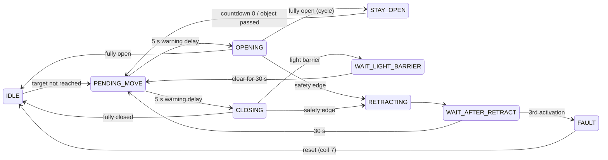

# PLC program

## Building and uploading

Use the Arduino IDE (https://www.arduino.cc/en/software).

## Last PLC program version

See Arduino sketch `main-plc_YYYY-MM-DD`.

## Gate control principle

Each door has a **target** (none / open / closed), which is set by Modbus TCP
server or the force open key box (for rescue services). A state machine per door moves the door towards its target.

**REMOVE ASAP! Just test mermaid @ Github**

## Modbus RTU (VFDs)

The two ATV320 VFD's (Modbus RTU address 1 and 2) share one RS485 bus. The PLC writes the command word (CMD) and speed reference (LFR) and reads the status word (ETA) and output frequency (RFR).

The `test-rs485_***`-sketch is a stand-alone tool for troubleshooting the RS485-bus via PLC serial communication.

## Modbus TCP server

The PLC hosts a Modbus TCP server for up to 3 clients at the same time. The full register map (plc-modbus-tcpip-server-setup_***.ods) is available in [`communication/`](communication).

| Type | Address | Function |
|---|---|---|
| Coil | 0 / 3 | Gate 1 / 2: start cycle (open → stay open → close) |
| Coil | 1 / 4 | Gate 1 / 2: stop (pause). Cleared automatically after 10 min |
| Coil | 2 / 5 | Gate 1 / 2: close |
| Coil | 6 | Close after an object has passed the light barrier (both gates) |
| Coil | 7 | Reset all faults (PLC and VFDs) |
| Coil | 8 | Warning: gate is obstructed (set by the PLC) |
| Coil | 9 | External floodlight |
| Input register | 0 | Status summary: end positions, VFD fault, state, force open, PLC fault |
| Input register | 1–3 | Debug: PLC inputs and relay outputs |
| Input register | 4–7 | Debug: VFD status (ETA) and user-requested VFD registers |
| Input register | 8 / 9 | Gate 1 / 2 fault code |
| Holding register | 0 | Stay-open countdown [s] (shared, maximum 43200) |
| Holding register | 1 | Traffic counter |
| Holding register | 2 / 3 | Debug: VFD 1 / 2 register address to read |

## Recommended Slack functionality

The document `slack-functionality_***.ods` in [`communication/`](communication) outlines expected user functionality in [Slack](https://slack.com/intl/en-gb/).

## Serial debug

Debugging is available via PLC Serial interface. Connect a USB cable to Controllino PLC. There is a dedicated M20 cable gland plug installed in front of the PLC USB port in the control enclosure for quick access to the USB port. Read further DEBUG instructions in the last revision PLC Arduino sketch.
