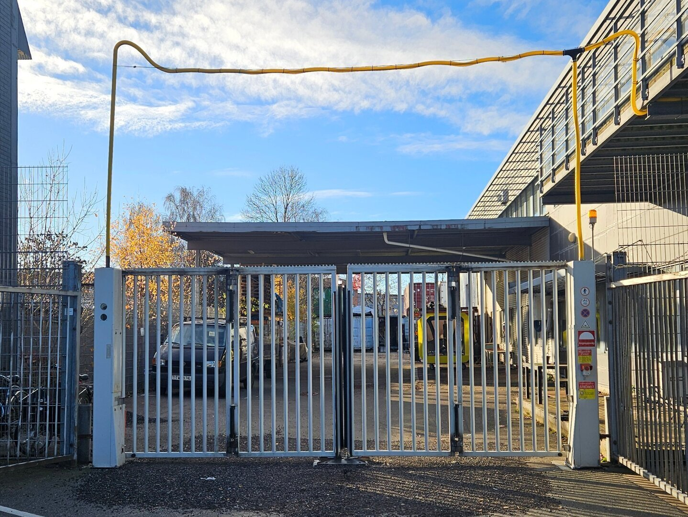
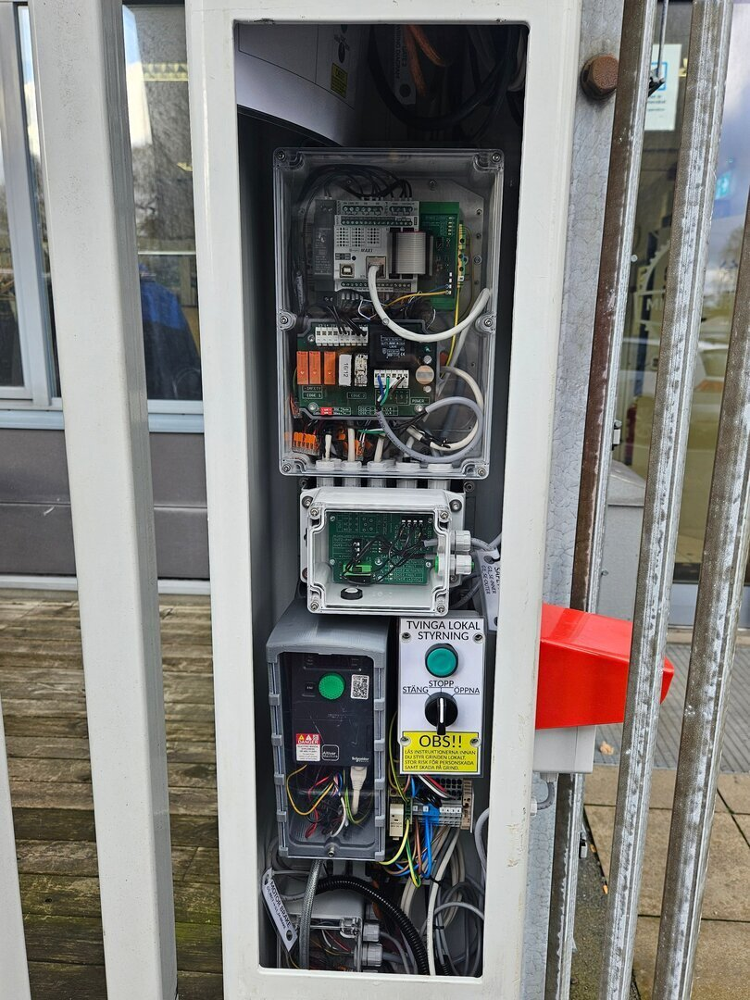
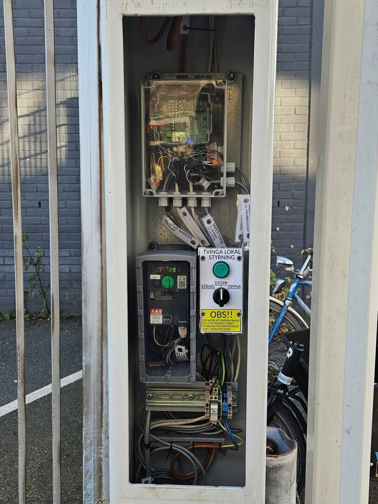
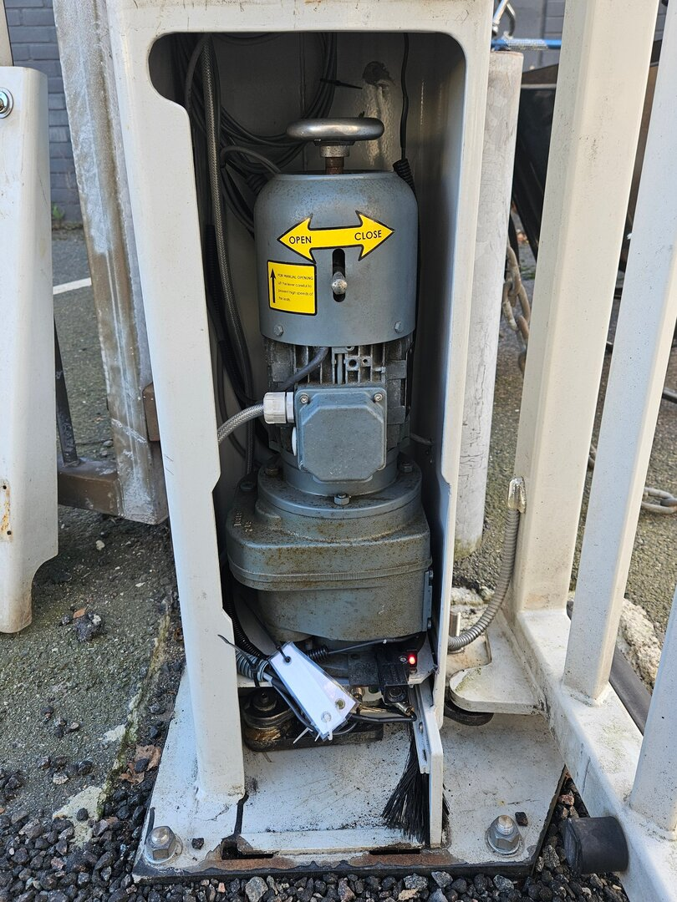
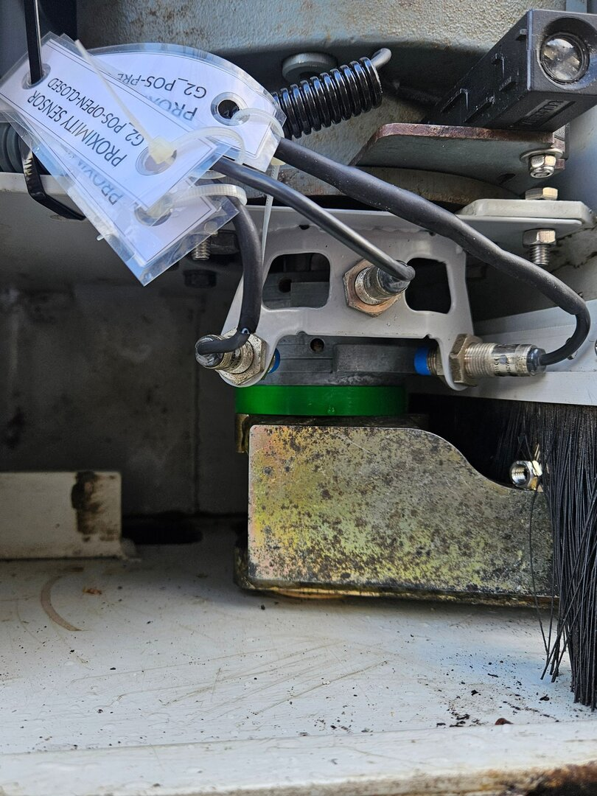
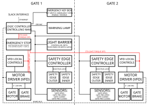

# Mikrofabrikens bifolding speedgate

## Overview
Mikrofabriken purchased a second hand motorized two-door bifolding gate in xxxx-xx. It has been installed, heavily modified and is currently in use on the premises. This repository is a collection of technical details about the gate and specifically the new in-house made control system.

## System overview
| Gate 1 control system | Gate 2 control system |
|---|---|
|  |  |

| Gate 2 drive mechanism (motor and reduction gear) | Gate 2 position sensors |
|---|---|
|  |  |

### Hardware

| Function | Component |
|---|---|
| PLC | CONTROLLINO MAXI (https://www.controllino.com/product/controllino-maxi-automation/) 4 × input extension (project https://github.com/ste-man/controllino-maxi-input-extension) |
| Motor drives | 1 × Schneider Electric Altivar Machine ATV320U04M2C (0.37 kW) 1 × Schneider Electric Altivar Machine ATV320U07M2C (0.75 kW)|
| Gearmotor | 2 × KEB G33C DM71K6 B02MB HR (6-pole, i = 177.27, ≈ 5.2 rpm output, spring-applied brake with hand release) |
| Position sensors | Inductive M12 PNP proximity sensors (Panasonic GX-200 series, SICK IME12), 3 per door |
| Safety edges | Safety edge interface (project https://github.com/ste-man/safety-edge-interface) inner and outer safety edges for each door |
| Light barrier | Vitector / Raytector light barrier with safety controller |

Available datasheets and manuals are in [`device-information/`](device-information).

### New control System

The new gate control system is built around a **CONTROLLINO MAXI** PLC (ATmega2560, Arduino compatible). The PLC drives one **Schneider Electric ATV320** variable frequency drive (VFD) per gate door over **Modbus RTU (RS485)**. The PLC hosts a **Modbus TCP/IP** server for control and monitoring over LAN. Emergency stop functionality (STO - Safe Torque Off) is hardwired directly to VFS's. VFD direct local control is available as backup.

2026-11-23: The gate (Modbus TCP/IP server) is currently controlled by a device from the project [ufAccessControlSystem](https://gitlab.mikrofabriken.se/mikrofabriken/ufaccesscontrolsystem) (limited access) acting as a gateway between the gate and Mikrofabriken users at [Slack](https://slack.com/intl/en-gb/).

### Block diagram

### Gate position sensing logic

Each door has three proximity sensors located at the reduction gear output shaft: 
**fully open/closed** (one shared sensor) 
**pre-open** 
**pre-closed**

Together the sensors provide four positions: 
**fully open** 
**pre-open zone** 
**pre-closed zone** 
**fully closed** 

The gate slows down inside pre-zones and moves at higher speed outside them. Invalid sensor combinations are detected and give a fault. A GNU Octave script in [`calculate-position-of-proximity-sensors`](calculate-position-of-proximity-sensors) plots gate movement speed and angle which makes it simple to iterate suitable sensor positions.

### Electrical wiring diagram

Electrical wiring diagram is available in [`ecad/`](ecad). The diagram is created in the software QElectroTech (https://qelectrotech.org/).

## Versioning

Files considered "more important" are versioned by date in the file or folder name (`_YYYY-MM-DD`). Some older revisions are kept for reference, and the **newest date is the current version**.

## Project timeline

| Date | Event |
|:-----|:------|
| YYYY-MM-DD | Gate purchased. More info. |
| YYYY-MM-DD | Gate collected in xxx. More info and device history. |
| | Lots of events?? |
| 2025-12 | Gate pillar support ground work and gate mounted |
| 2026-03 | Gate moving and partly functional. Password is required to access gate controller (FEIG TST-FUZ**) settings, but password for gate controller was not available. Gate controller was dismantled and an effort was made to brute force guess the controller password with an Arduino Uno. 65536 (0xFFFF) passwords were tested over an ~8 day period, but there was no success. |
| 2026-04 | Due to the failed password guessing project, it was decided to build a complete new control system for the gate. A second hand VFD was purchased for testing and evaluation purposes. |
| 2026-05 | Gate center support installed and related ground work |
| 2026-07 | Testing and evaluating new motor VFD's. Designing new control system. |
| 2026-08 | Assembly of new control system. |
| 2026-09 | Installation of new control system and required cables for the gate. |
| 2026-09-22 | An attempt to calibrate gate lever shaft positions resulted in complete failure. Previous position indication system was deemed inadequate due to crosstalk between sensors and it was decided to manufacture a new position indication system. |
| 2026-10 | New position indication system designed and manufactured. Both motor assemblies removed and re-installed with new position indication systems. |
| 2026-11-22 | Gate with new control system commissioned. |
